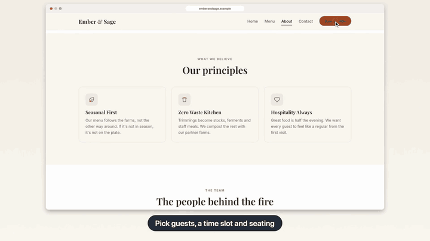

# app-demo-video

A [Claude Code](https://claude.com/claude-code) skill that turns a user journey through your app into a calm,
captioned demo video, and regenerates it with one command after the UI changes.

> **Requires Claude Code on macOS.** It doesn't work in Claude Chat (claude.ai): skills there run in
> a cloud Linux sandbox that can't reach your app, simulators or browser, and captions are rendered
> with macOS CoreText.



*Excerpt from a demo of a mock restaurant website. The skill wrote the journey, recorded it and
edited the video: drawn cursor, follow-zoom, click ripples, captions.
[Watch the full 77-second video](docs/ember-and-sage-demo.mp4) · [see how it was made](#example-restaurant-website).*

## What it does

Ask Claude for a demo video ("make a demo video of the checkout flow") and the skill:

1. reads your app's screens and routes and settles the story with you;
2. writes a script that drives the app and logs named moments ("marks") on the recording's clock;
3. records every screen or device involved;
4. cuts on those marks into a finished video with intro/outro cards, step captions, cross-fades,
   click sounds and optional music.

Everything is a file in your project's `demo/` folder, so the next take is `demo/make-video.sh`.

| Project type | Driven by | Recorded with | Output |
|---|---|---|---|
| Mobile (iOS / Android, React Native, Expo, native) | Maestro flows | `simctl recordVideo` / `scrcpy` | Portrait 1080×1920 + landscape 1920×1080, phone bezels |
| Web (sites, dashboards, widgets, iframes) | Playwright | Chrome DevTools screencast | 1920×1080 browser window, drawn cursor, follow-zoom, click sounds |
| Desktop app, CLI, anything else | Your script or by hand | ffmpeg screen capture | 1920×1080 |

Highlights:

- **Multi-device journeys** (passenger + driver, buyer + seller, two chat users) on one synchronized timeline.
- **Captions in any language.** Text is rendered with macOS CoreText, so Thai, Arabic and CJK shape correctly.
- **Re-edit without re-recording.** Captions, timing, camera, cursor and sound live in `demo/video.json`.
- **Local only.** Nothing is uploaded; no cloud recorders or editing services.

## Requirements

- **macOS** (CoreText captions via `swift`; iOS Simulator; `avfoundation` screen capture)
- Claude Code
- `ffmpeg` / `ffprobe` (`brew install ffmpeg`), `python3`, Xcode Command Line Tools (`swift`)
- **Web:** `pip install playwright pillow` and `python3 -m playwright install chromium`
- **Mobile:** [Maestro](https://maestro.mobile.dev) (Java 17+), Xcode simulators and/or Android emulator + `scrcpy` (`brew install scrcpy`)

You don't need everything up front: the skill checks for the tools your project needs and asks
before installing anything.

## Install

**As a plugin (recommended, easy to update).** In Claude Code:

```
/plugin marketplace add zZBANK22Zz/Demo-Video
/plugin install app-demo-video@app-demo-video
```

**As a personal skill.** Clone anywhere and link the skill folder:

```bash
git clone https://github.com/zZBANK22Zz/Demo-Video.git
ln -s "$PWD/Demo-Video/skills/app-demo-video" ~/.claude/skills/app-demo-video
```

`git pull` in the clone updates it. To share it with a team through one repository, copy
`skills/app-demo-video` into that project's `.claude/skills/` instead.

## Usage

Just ask, for example:

- "Make a demo video of the sign-up and first order flow in the iOS app."
- "Record a walkthrough of the dashboard: create a report and export it as PDF."
- "Make a demo where the passenger books a ride and the driver accepts it, both phones side by side."
- "The settings screen changed, regenerate the demo video."

Or invoke it directly with `/app-demo-video` (`/app-demo-video:app-demo-video` when installed as a plugin).

The skill creates in your project:

```
demo/
  make-video.sh    record + edit  (--record: record only · --edit-only: re-render the last take)
  record.py        web journey (Playwright)        or  flows/*.yaml  mobile journeys (Maestro)
  video.json       captions, intro/outro, brand colours, camera, sound
  out/             recordings and the finished .mp4 (git-ignored)
```

Add music by putting a track you own or have licensed at `demo/assets/music.mp3` and running
`demo/make-video.sh --edit-only`.

## Example: restaurant website

[`examples/restaurant-website/`](examples/restaurant-website) is a 5-page static HTML/CSS mockup of a
fictional restaurant, Ember & Sage, together with the `demo/` folder the skill generated for it.

**Result:** [`docs/ember-and-sage-demo.mp4`](docs/ember-and-sage-demo.mp4), 77 s, 1920×1080, 30 fps,
click sounds (no music). The journey: home page → menu and its category tabs → about and the team →
filling in a reservation → contact page and FAQ, with one caption per step.

| File | What it holds |
|---|---|
| [`demo/record.py`](examples/restaurant-website/demo/record.py) | The journey: one block per caption, each starting with a mark, a camera move, then the actions |
| [`demo/video.json`](examples/restaurant-website/demo/video.json) | Captions cut on those marks, intro/outro cards, brand colours, per-step speed |
| [`demo/make-video.sh`](examples/restaurant-website/demo/make-video.sh) | Serves the site on port 3099 with `python3 -m http.server`, records, renders |

Run it yourself (needs the web requirements above; takes about 3 minutes):

```bash
cd examples/restaurant-website
demo/make-video.sh                # record + render → demo/out/ember-and-sage-demo.mp4
demo/make-video.sh --edit-only    # after editing video.json: re-render without recording
```

Photos are loaded from [Unsplash](https://unsplash.com), so recording needs an internet connection.

## Ground rules the skill follows

- Seeded/test data only: no real users, phone numbers, e-mails or payment data in a video.
- It doesn't change your app's behaviour for the video. At most it adds a few test ids, and it lists them.
- It asks before installing anything, and before using any real account.
- Recordings stay on your machine.

## Repository layout

```
.claude-plugin/          plugin + marketplace manifests
skills/app-demo-video/
  SKILL.md               the workflow Claude follows
  references/            web, mobile config, Android, lessons learned (symptom → cause → fix)
  scripts/               recorder, editors, caption renderer (used as is)
  templates/             starting points copied into your project's demo/
examples/restaurant-website/   example site + the demo/ folder generated for it
docs/                    README GIF and the example's finished video
```

## License

[MIT License](LICENSE) © zZBANK22Zz
